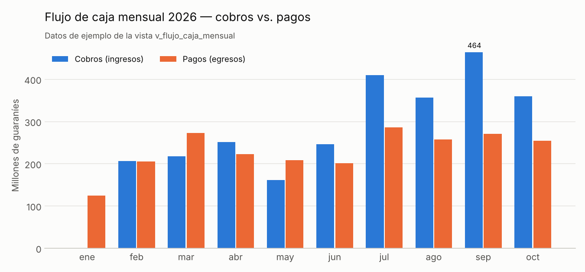
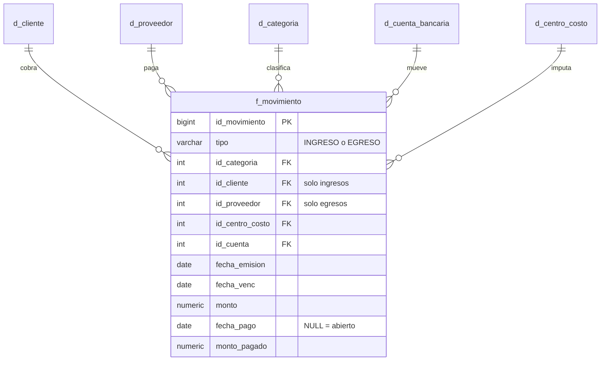

# ERP financiero en PostgreSQL

Modelo de datos financiero para una empresa de servicios de ingeniería: cuentas a cobrar y a pagar, flujo de caja, vencimientos y margen por obra. Las reglas de negocio viven en la base de datos (restricciones, trigger y procedimiento), y las vistas quedan listas para reportes en Power BI.



## El problema

En muchas empresas medianas, el control financiero está repartido en planillas: cada área anota a su manera, los vencimientos se escapan y nadie sabe con certeza el margen de cada obra. Se necesita una base única, con reglas que impidan datos inconsistentes.

## La solución

- **Modelo dimensional simple:** tablas de dimensiones (`d_`) y una tabla de hechos (`f_movimiento`) con IDs numéricos y poco texto.
- **Reglas en la base:** un ingreso siempre tiene cliente y un egreso siempre tiene proveedor; el pago se registra completo (fecha y monto juntos); el tipo del movimiento debe coincidir con su categoría (trigger).
- **Procedimiento `sp_registrar_pago`:** registra la baja de un movimiento y rechaza pagos duplicados.
- **Vistas para reportes:** flujo de caja con saldo acumulado, cuentas por cobrar por antigüedad, alertas de vencimiento (hoy y mañana), resultado mensual y margen por obra.
- **Índices parciales** para las consultas más frecuentes (movimientos abiertos por vencimiento).

## Modelo de datos



## Vistas

| Vista | Para qué sirve |
|---|---|
| `v_movimientos` | Movimientos con nombres y estado: PAGADO, VENCIDO, VENCE HOY, POR VENCER |
| `v_flujo_caja_mensual` | Cobros, pagos, neto y saldo acumulado por mes |
| `v_cuentas_por_cobrar` | Saldo abierto por cliente, separado por días de atraso |
| `v_alertas_vencimiento` | Lo que vence hoy o mañana (base para avisos automáticos por correo) |
| `v_resultado_mensual` | Resultado por grupo contable y mes |
| `v_margen_centro_costo` | Ingresos, egresos y margen por obra |

Ejemplo, margen por obra con los datos de ejemplo:

| Obra | Ingresos (Gs) | Egresos (Gs) | Margen |
|---|---:|---:|---:|
| OB-101 Edificio Residencial Las Palmas | 1.163.898.000 | 786.522.000 | 32,4 % |
| OB-103 Puente Arroyo Seco | 1.077.659.000 | 787.607.000 | 26,9 % |
| OB-102 Centro Logístico Ruta 2 | 1.014.605.000 | 758.538.000 | 25,2 % |

## Cómo ejecutarlo

Con Docker (crea la base y carga los datos de ejemplo):

```bash
git clone https://github.com/dorneleslfd-design/erp-financiero-postgres.git
cd erp-financiero-postgres
docker compose up -d
psql -h localhost -U erp -d erp -f sql/04_consultas_ejemplo.sql   # contraseña: erp
```

Sin Docker, en cualquier PostgreSQL 13+ (por ejemplo, Supabase):

```bash
psql -d mi_base -f sql/01_esquema.sql
psql -d mi_base -f sql/02_vistas.sql
psql -d mi_base -f sql/03_datos_ejemplo.sql
```

Los datos de ejemplo van hasta el 31/10/2026. Para que las vistas de estado y alertas usen esa fecha: `SET erp.hoy = '2026-10-31';`. Sin esa línea, usan la fecha actual.

## Estructura

```
erp-financiero-postgres/
├── sql/
│   ├── 01_esquema.sql           # Tablas, restricciones, trigger, índices y procedimiento
│   ├── 02_vistas.sql            # Vistas para reportes y Power BI
│   ├── 03_datos_ejemplo.sql     # Datos ficticios reproducibles (ene–oct 2026)
│   └── 04_consultas_ejemplo.sql # Consultas de ejemplo
├── docs/flujo-caja.png
└── docker-compose.yml
```

## Tecnologías

PostgreSQL 16, SQL, PL/pgSQL (trigger y procedimiento), vistas con funciones de ventana y `FILTER`, Docker Compose. Las vistas se conectan directo a Power BI.

---

Datos ficticios. Proyecto de portafolio inspirado en un sistema financiero real que desarrollé para una empresa de ingeniería.

Autor: **Leonardo Dorneles** · [LinkedIn](https://www.linkedin.com/in/leonardo-dorneles-78b17130)
